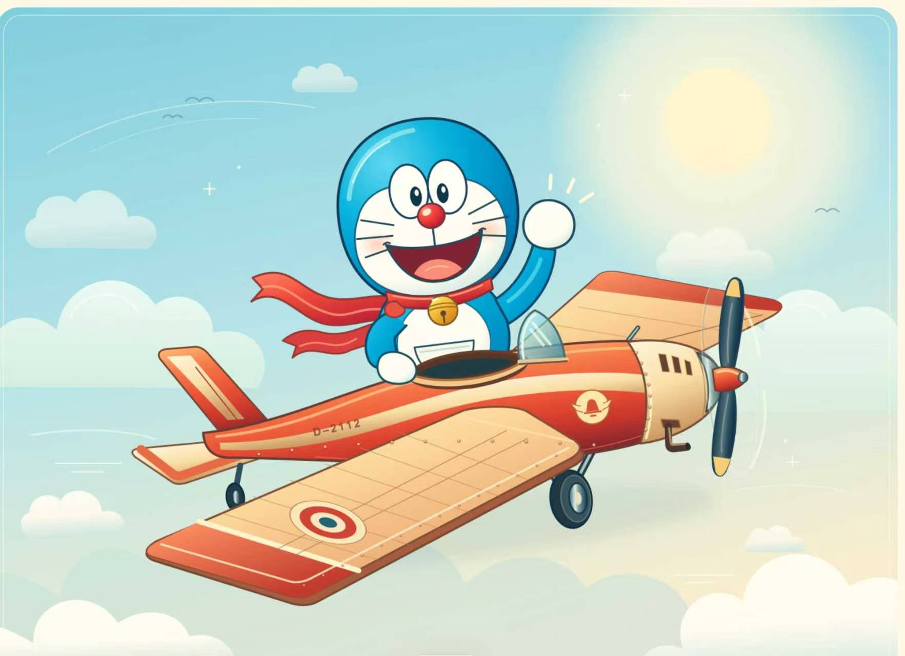

# AI 模型能力测试对比

**提示词**

```text
画一只叮当猫坐在飞机上，要足够精致细腻     svg 格式
```

| 模型 | 思考深度 | 结果截图 |
| --- | --- | --- |
| fable5.1 | medium | [](results/fable5.1/002/result.png) |
| fable5.2 | high | [](results/fable5.2/001/result.png) |
| astra-6 | high | [](results/astra-6/001/result.jpg) |
| opus5.5 | high | [](results/opus5.5/001/result.jpg) |
| 6.1 sol | high | [](results/6.1-sol/001/result.png) |
| deepseek 4.1 flash | high | [](results/deepseek-4.1-flash/001/result.png) |
